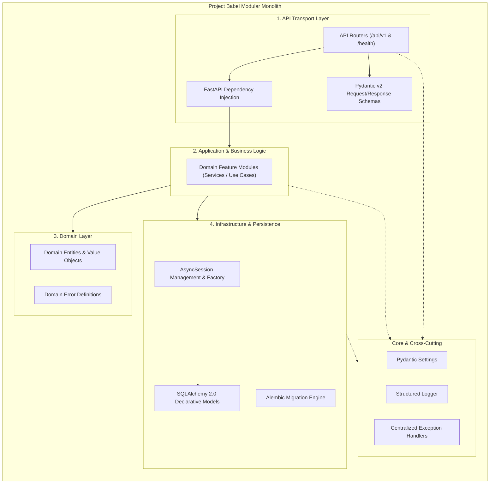
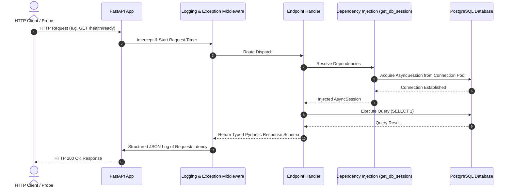

# Backend Architecture: Project Babel

This document outlines the architectural principles, layer responsibilities, dependency rules, and execution lifecycles implemented in the Project Babel backend foundation.

---

## 1. Architectural Pattern: Modular Monolith

Project Babel utilizes a **Modular Monolith** architecture. The monolith provides a single unified deployment unit while maintaining rigorous, code-enforced domain boundaries and strict separation of concerns.

---

## 2. Layer Separation & Responsibilities

| Layer | Directory Path | Responsibility | Boundary Rules |
| :--- | :--- | :--- | :--- |
| **API Layer** | `backend/app/api/` | HTTP request routing, parameter parsing, status codes, OpenAPI schema definitions. | **No database queries or direct SQL.** Interacts only with application services via Dependency Injection. |
| **Application Layer** | `backend/app/modules/` | Orchestrates business workflows, coordinates domain rules, enforces transactions. | Independent of HTTP transport (no `Request` or `Response` objects). |
| **Domain Layer** | `backend/app/domain/` | Pure business entities, value objects, domain events, domain exceptions. | Zero external dependencies; framework-agnostic. |
| **Infrastructure Layer**| `backend/app/infrastructure/`| Database access, ORM persistence, caching adapters, third-party integrations. | Implements repository interfaces using SQLAlchemy 2.0 async sessions. |
| **Core** | `backend/app/core/` | Centralized settings, structured logging, custom exception hierarchies. | Imported across layers as a shared cross-cutting utility. |

---

## 3. Dependency Direction Rule

Dependencies strictly flow **inward** or **downward**:

$$\text{API Layer} \longrightarrow \text{Application Layer} \longrightarrow \text{Domain Layer}$$
$$\text{Infrastructure Layer} \longrightarrow \text{Domain Layer}$$

- Higher layers (e.g., API) depend on lower layers (Application, Domain).
- Lower layers never import from higher layers (e.g., Domain never imports API routes or FastAPI dependencies).
- Circular imports are strictly disallowed and caught during linting and typechecking.

---

## 4. HTTP Request Lifecycle

---

## 5. Database Connection Lifecycle

1. **Engine Initialization**:
   During application startup within the `lifespan` context manager, `get_engine()` initializes a single `AsyncEngine` using connection pool parameters (`pool_size`, `max_overflow`, `pool_timeout`, `pool_recycle`).
2. **Per-Request Session Acquisition**:
   FastAPI endpoints declare `db: AsyncSession = Depends(get_db_session)`. An `AsyncSession` is yielded from `get_session_factory()`.
3. **Automatic Transaction Boundary & Rollback**:
   If an unhandled exception or database fault occurs during the request, the generator catches the error, triggers `await session.rollback()`, and propagates the exception to the centralized exception handler.
4. **Guaranteed Session Disposal**:
   A `finally:` block in `get_db()` guarantees that `await session.close()` is invoked, returning the connection to the connection pool.
5. **Engine Teardown**:
   When the ASGI server receives a SIGTERM or SIGINT shutdown signal, the `lifespan` context executes `await close_db_engine()`, releasing all pooled connections gracefully.
