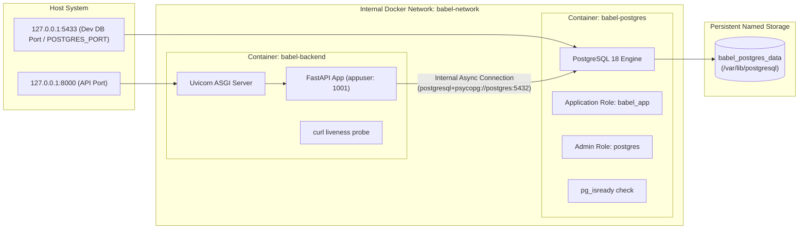

# Docker Infrastructure Architecture: Project Babel

This document describes the container architecture, service topology, networking, volume persistence, security posture, and health checks configured for Project Babel local development and testing.

---

## 1. Container Topology & Service Responsibilities



---

## 2. Service Definitions

### 2.1 Backend Service (`babel-backend`)
- **Base Image**: `python:3.12-slim` (Debian-based minimal image).
- **Execution Security**: Runs as an unprivileged system user (`appuser`, UID/GID 1001). Never runs as root.
- **Port Exposure**: Listens on internal port `8000`, forwarded to host `127.0.0.1:8000`.
- **Startup Sequencing**: Defines `depends_on: postgres` with `condition: service_healthy`. The backend container will not start until PostgreSQL has passed its initial readiness checks.
- **Healthcheck**: Probes `http://localhost:8000/health/live` every 10 seconds using `curl`.

### 2.2 PostgreSQL Service (`babel-postgres`)
- **Base Image**: `postgres:18-alpine`.
- **Dedicated Application User**: Automatically executes `infrastructure/docker/postgres/init-app-db.sh` on first initialization to create the `babel_app` role with standard DDL and DML permissions on database `babel_db`. The backend does not connect using the `postgres` superuser.
- **Port Exposure**: Bound to `127.0.0.1:${POSTGRES_PORT:-5433}:5432` to avoid conflicts with native PostgreSQL services running on the default port `5432` on Windows hosts.
- **Volume Mount**: Mounted to `/var/lib/postgresql` conforming to PostgreSQL 18 major-version subdirectory and cluster management standards.
- **Healthcheck**: Uses `pg_isready -U postgres -d babel_db` every 5 seconds to verify engine readiness before dependent services connect.

---

## 3. Persistent Volumes

Database records and schema definitions are stored in a persistent named Docker volume:

```yaml
volumes:
  postgres_data:
    name: babel_postgres_data
```

This volume persists across `docker-compose down` and `docker-compose up` cycles. To purge database state completely during testing, execute:

```bash
docker-compose down -v
```

---

## 4. Docker Networking & Security Isolation

- **Bridge Network**: Services communicate across an isolated custom bridge network named `babel-network`.
- **DNS Resolution**: Containers resolve each other using their service names (`postgres` resolves directly to the database container's internal IP).
- **Loopback Binding**: Host port bindings (`127.0.0.1:8000` and `127.0.0.1:5432`) bind strictly to localhost to prevent accidental network exposure on public interfaces.
