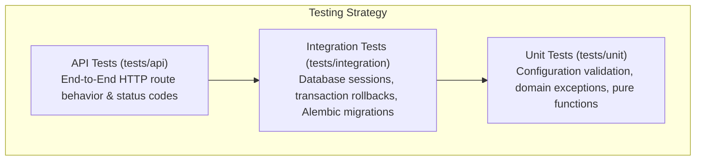

# Testing Strategy & Quality Assurance: Project Babel

This document outlines the testing pyramid, test tiers, fixture strategies, and CI quality gates configured for Project Babel.

---

## 1. The Testing Pyramid

Project Babel adheres to a clear three-tier testing strategy:



---

## 2. Test Directory Structure

```text
backend/tests/
├── conftest.py              # Global fixtures (test settings, AsyncClient, DB session mocks)
├── unit/
│   ├── test_config.py       # Pydantic Settings, environment flags, URL masking
│   └── test_exceptions.py   # Domain exceptions & FastAPI exception handlers
├── integration/
│   ├── test_database.py     # Session generator lifecycle, rollbacks, connectivity checks
│   └── test_migrations.py   # Alembic revision loadability & metadata consistency
└── api/
    └── test_health.py       # /health, /health/live, /health/ready (success and 503 scenarios)
```

---

## 3. Test Isolation & Database Fixtures

- **Zero Contamination**: Tests never operate against production databases or live credentials.
- **Dependency Overrides**: The `async_client` fixture in `conftest.py` leverages FastAPI's `app.dependency_overrides` to inject mock database sessions for API probe testing, ensuring that unit and API tests can run fast without requiring external services.
- **Dedicated CI Database**: In the GitHub Actions workflow, an isolated PostgreSQL service container (`babel_test_db`) is spun up specifically for migration and live transaction testing.

---

## 4. Quality Gates & Enforcement

Every pull request and commit must satisfy the following automated gates:

1. **Ruff Linting**: Zero lint violations (`ruff check backend/`).
2. **Ruff Formatting**: Code must conform strictly to PEP 8 standards with an 88-character line length (`ruff format --check backend/`).
3. **Mypy Static Typing**: Strict type checking with zero untyped definitions in application source code (`mypy backend/app`).
4. **Pytest Coverage**: Automated test suite must pass with at least 80% code coverage on core application modules (`pytest backend/tests --cov=app --cov-fail-under=80`).
5. **Docker Build Verification**: Docker image must compile cleanly from `backend/Dockerfile`.
