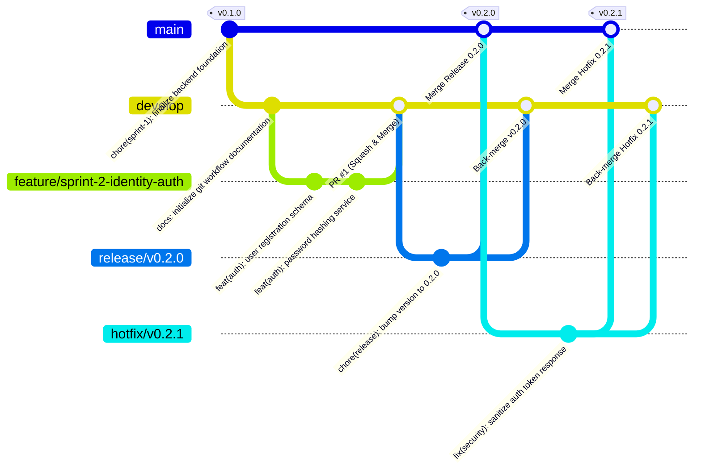

# Project Babel — Git Branching Strategy & Workflow Guide

This document defines the official Git branching strategy, Conventional Commits specification, Pull Request lifecycle, and release protocols for **Project Babel**.

---

## 1. Branching Strategy Architecture

Project Babel uses a modified GitFlow branching model engineered for high testability, clean commit history, and strict separation between active development and stable release baselines.



---

## 2. Branch Hierarchy & Protection Policies

### Permanent Branches

| Branch | Lifecycle | Protection Rules | Purpose |
| :--- | :--- | :--- | :--- |
| **`main`** | Permanent | **Strictly Protected.** Direct pushes disallowed. Requires passing CI, required status checks, and approved PR from `develop` or `release/*` / `hotfix/*`. | Production-ready, verified milestone releases. Represents stable, deployed code. |
| **`develop`** | Permanent | **Protected.** Direct pushes disallowed. Requires passing CI and approved PR from `feature/*` or `bugfix/*`. | Central integration branch. All completed features merge here. Must remain green and buildable at all times. |

### Supporting Branches

| Branch Pattern | Base Branch | Target Branch | Merging Policy | Purpose |
| :--- | :--- | :--- | :--- | :--- |
| **`feature/*`** | `develop` | `develop` | **Squash and Merge** (single clean commit) | Implementation of user stories, architectural spikes, and sprint deliverables. |
| **`bugfix/*`** | `develop` | `develop` | **Squash and Merge** | Non-critical bug repairs identified during sprint testing on `develop`. |
| **`release/*`** | `develop` | `main` & `develop` | **Merge Commit** | Release stabilization, final documentation polish, metadata/version bump. |
| **`hotfix/*`** | `main` | `main` & `develop` | **Merge Commit** | Urgent production fixes addressing critical defects or security vulnerabilities. |
| **`chore/*`** | `develop` | `develop` | **Squash and Merge** | Maintenance, tooling updates, or repository housekeeping tasks. |

---

## 3. Branch Naming Conventions

All branch names must follow kebab-case naming preceded by the appropriate prefix:

```text
<type>/<issue-or-sprint-id>-<short-description>
```

### Examples:
- **Feature**: `feature/sprint-2-identity-auth`, `feature/BABEL-104-user-profile`
- **Bugfix**: `bugfix/BABEL-142-db-connection-leak`
- **Hotfix**: `hotfix/v0.1.1-auth-header-null-check`
- **Release**: `release/v0.2.0`
- **Chore**: `chore/upgrade-psycopg-3`
- **Docs**: `docs/update-architecture-diagrams`

---

## 4. Conventional Commits 1.0.0 Standard

Project Babel strictly adheres to the [Conventional Commits 1.0.0](https://www.conventionalcommits.org/en/v1.0.0/) specification.

### Commit Format

```text
<type>(<scope>): <subject>

[optional body describing why and what changed]

[optional footer(s) such as Closes #123 or BREAKING CHANGE: description]
```

### Approved Types

- **`feat`**: A new feature for the application or end user.
- **`fix`**: A bug fix for a known defect.
- **`docs`**: Documentation changes only (e.g. Markdown guides, diagrams).
- **`style`**: Formatting, whitespace, missing semicolons (no code logic changes).
- **`refactor`**: Code changes that neither fix a bug nor add a feature.
- **`perf`**: Performance optimizations.
- **`test`**: Adding new tests or correcting existing tests.
- **`build`**: Changes affecting the build system or external dependencies (`pyproject.toml`, Dockerfile).
- **`ci`**: Changes to CI/CD workflows and configuration files (`.github/workflows/`).
- **`chore`**: Maintenance, repo setup, configuration files.
- **`revert`**: Reverting a previous commit.

### Approved Scopes

- `auth`, `api`, `users`, `messages`, `database`, `alembic`, `core`, `config`, `logging`, `docker`, `deps`, `workflow`, `sprint-1`, `sprint-2`.

### Formatting Rules

1. **Imperative Mood**: Use "add", "implement", "fix", not "added", "implements", "fixing".
2. **Lowercase Subject**: Start the subject with a lowercase letter.
3. **No Trailing Period**: Do not end the subject with a period (`.`).
4. **Length Limit**: Keep the subject line under 72 characters.
5. **Breaking Changes**: Append a `!` after type/scope (e.g., `feat(api)!: remove v1 deprecated endpoint`) or include `BREAKING CHANGE:` in the commit footer.

### Commit Examples

```bash
# Feature commit
git commit -m "feat(auth): implement user registration password hashing"

# Bug fix commit
git commit -m "fix(database): configure statement timeout on async engine"

# Documentation commit
git commit -m "docs(workflow): document pull request and branch lifecycle"

# Chore commit
git commit -m "chore(deps): update ruff to 0.4.8"
```

---

## 5. Pull Request Lifecycle & Review Standards

### 1. Preparation Before Opening a PR
Before submitting a PR targeting `develop`:
```bash
# 1. Ensure your local branch is rebased on latest develop
git checkout develop
git pull origin develop
git checkout feature/sprint-2-identity-auth
git rebase develop

# 2. Run linting & formatting checks
ruff check backend/
ruff format --check backend/

# 3. Run type checking
mypy backend/src

# 4. Run automated test suite with coverage
pytest backend/tests/ -v --cov=app --cov-report=term-missing
```

### 2. Pull Request Template
Every PR must complete the checklist provided in `.github/PULL_REQUEST_TEMPLATE.md`:
- Link to relevant issue or sprint scope.
- Description of changes and technical decisions.
- Verification evidence (terminal output, test passes, logs).
- Adherence to testing coverage threshold (minimum 80%).

### 3. Review & Approval Gates
- **Peer Review**: At least 1 Senior Engineer approval required.
- **Automated CI**: GitHub Actions workflow (`backend-ci.yml`) must pass completely:
  - Docker Compose configuration and build verification.
  - Linting (`ruff check`) and formatting (`ruff format --check`).
  - Type checking (`mypy`).
  - Unit and integration tests (`pytest`).
- **Merge Strategy**:
  - `feature/*` into `develop`: **Squash and Merge** (produces a single atomic commit with Conventional Commit title).
  - `release/*` into `main`: **Create a Merge Commit** (preserves release history).
  - `main` back-merge into `develop`: **Create a Merge Commit**.

---

## 6. Merge Conflict Resolution & Rebasing Protocol

To maintain a clean, linear commit history, **never create merge bubble commits** when pulling changes from `develop` into your feature branch. Always use `git rebase`.

### Safe Rebasing Workflow

```bash
# 1. Fetch latest changes from remote
git fetch origin

# 2. Switch to feature branch
git checkout feature/<branch-name>

# 3. Rebase on top of develop
git rebase origin/develop

# 4. If conflicts occur:
# Inspect conflicted files
git status

# Resolve conflicts manually in each file, then stage resolved files:
git add <resolved-file>

# Continue rebase:
git rebase --continue

# 5. Push rebased branch to remote (use --force-with-lease ONLY on your feature branch):
git push --force-with-lease origin feature/<branch-name>
```

> [!CAUTION]
> Never use `--force` or `--force-with-lease` on `main` or `develop`. These branches are protected and direct force pushes are strictly prohibited by repository policy.

---

## 7. Developer Cheat Sheet

### Starting a New Feature
```bash
# Always start from up-to-date develop
git checkout develop
git pull origin develop
git checkout -b feature/sprint-2-identity-auth
```

### Daily Development & Committing
```bash
# Check working tree status
git status

# Stage specific changes
git add backend/app/modules/auth/

# Commit with conventional format
git commit -m "feat(auth): add user registration service"

# Push to your feature branch
git push -u origin feature/sprint-2-identity-auth
```

### Synchronizing with Mainline
```bash
git fetch origin
git rebase origin/develop
```

### Post-Merge Cleanup
```bash
# Switch to develop and pull latest merged changes
git checkout develop
git pull origin develop

# Delete local feature branch
git branch -d feature/sprint-2-identity-auth

# Prune remote branch references
git fetch --prune origin
```
